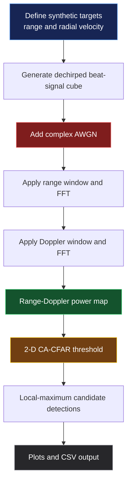

# 📡 Radar Signal Processing & Target Detection Simulator

<p align="center">
  <strong>FMCW-style range–Doppler processing, synthetic target echoes, and 2-D CA-CFAR detection</strong><br>
  Python · NumPy · SciPy · Matplotlib · GNU Radio Companion
</p>

<p align="center">
  
  
  
  
</p>

## ✨ Overview

This project demonstrates a reproducible radar signal-processing workflow using synthetic, dechirped FMCW-style beat data. It simulates targets at known ranges and radial velocities, adds complex Gaussian noise, computes a Range–Doppler map, and applies a 2-D Cell-Averaging Constant False Alarm Rate (CA-CFAR) detector.

The repository contains two complementary parts:

- **Python simulation:** computes range and Doppler axes, plots the range profile and Range–Doppler map, applies CA-CFAR, and exports candidate detections to CSV.
- **GNU Radio flowgraph:** visualizes two synthetic beat-frequency tones representing target ranges, with a configurable channel-noise stage and QT GUI signal monitoring.

> **Scope note:** This is an educational simulation with synthetic baseband data. It does not connect to an RF front-end or represent an operational radar. The GRC flowgraph is a beat-frequency/range-spectrum demonstration; the 2-D Range–Doppler processing and CA-CFAR implementation are in the Python script.

## 🎞️ Simulation Preview

<p align="center">
  
</p>

The default Python run saves the following result plots:

| Output | Description |
|---|---|
| `results/range_profile.png` | Average beat-spectrum power mapped to range |
| `results/range_doppler_map.png` | Normalized range–velocity intensity map |
| `results/cfar_detection_map.png` | Range–Doppler map with CA-CFAR candidate detections |
| `results/cfar_detections.csv` | Ranked detected range/velocity candidates |
| `results/simulation_parameters.txt` | Parameters used for the run |

## 🧭 Processing Pipeline



## 📁 Repository Structure

```text
Radar-Signal-Processing-Target-Detection/
├── README.md
├── requirements.txt
├── flowgraphs/
│   └── Radar_Beat_Frequency_Range_Detection.grc
├── src/
│   └── radar_fmcw_simulator.py
├── tests/
│   └── test_radar_simulation.py
├── assets/
│   └── radar_analysis_preview.gif
└── results/
    ├── range_profile.png
    ├── range_doppler_map.png
    ├── cfar_detection_map.png
    ├── cfar_detections.csv
    └── simulation_parameters.txt
```

## 🧰 Requirements

### Python simulation

- Python 3.10 or newer
- NumPy
- SciPy
- Matplotlib

Install the dependencies:

```bash
python -m pip install -r requirements.txt
```

### GNU Radio flowgraph

- GNU Radio Companion 3.10.x or a compatible installation
- Qt GUI support
- No SDR hardware or external data files are needed for the included GRC flowgraph

## ▶️ Run the Python Radar Simulation

From the repository root:

```bash
python src/radar_fmcw_simulator.py
```

The script uses a fixed random seed for a reproducible noisy data set, then writes result plots and detection CSV files into `results/`.

To experiment, edit the parameters in `main()` inside `src/radar_fmcw_simulator.py`:

| Parameter | Default | Meaning |
|---|---:|---|
| `fs` | 2 MHz | Beat-signal sampling rate |
| `chirp_s` | 200 µs | Chirp repetition interval used for slow-time sampling |
| `slope` | 5 × 10¹¹ Hz/s | FMCW slope used for beat-frequency-to-range conversion |
| `fc` | 10 GHz | Carrier frequency used for Doppler-to-velocity conversion |
| `n_chirps` | 128 | Number of slow-time observations |
| `snr_db` | 15 dB | Simulated signal-to-noise ratio |
| `pfa` | 10⁻⁴ | CA-CFAR design false-alarm probability |

Two default synthetic targets are configured at 60 m / +12 m/s and 120 m / −5 m/s. These are simulation inputs, not measured targets.

## 📈 Signal-Processing Concepts

1. **Beat-frequency-to-range conversion**

   For a dechirped FMCW beat frequency \(f_b\) and chirp slope \(S\), the simple range estimate is:

   \[
   R \approx \frac{c f_b}{2 S}
   \]

   Here \(c\) is the speed of light. The simulator uses a simplified model and low-velocity range–Doppler coupling is not separately compensated.

2. **Doppler-to-velocity conversion**

   \[
   v_r = \frac{\lambda f_D}{2}, \qquad \lambda = \frac{c}{f_c}
   \]

3. **CA-CFAR detection**

   Training cells estimate local background power; guard cells reduce target leakage into that estimate. A threshold is then formed from the training-cell average and the selected design false-alarm probability. The achieved false-alarm rate can differ from the design value in finite, non-homogeneous data.

## 🔬 Experiments to Try

- Increase or decrease `snr_db` and compare the Range–Doppler map and CFAR detections.
- Change target ranges and radial velocities; check whether the peaks move in the expected axes.
- Change target amplitudes to test detection of a weaker target beside a stronger one.
- Vary `pfa`, training cells, and guard cells to investigate the detection-threshold trade-off.
- Compare the estimated range/velocity values against the simulation inputs and record the errors.

## 🧱 GNU Radio Flowgraph

Open `flowgraphs/Radar_Beat_Frequency_Range_Detection.grc` in GNU Radio Companion and press **Run**. It sums two complex beat-frequency tones, throttles the software-only stream, and shows an ideal signal monitor plus a channel-noisy monitor.

The tone frequencies are calculated using:

```text
fb = 2 * slope * range / c
```

The spectrum x-axis is in hertz. Convert a positive beat-frequency peak to an approximate range with `R = c * fb / (2 * slope)`.

The GRC file does not itself create an FMCW chirp, a 2-D Range–Doppler map, or a CFAR detection output. Those functions are implemented in the Python simulation above.

## ⚠️ Limitations

- Synthetic dechirped beat data are used instead of sampled RF chirps and a physical transmit/receive chain.
- The range–Doppler model is intended for learning and visualization; it omits many practical radar effects such as phase noise, multipath, clutter, range migration, and hardware nonlinearity.
- The CFAR implementation uses rectangular CA-CFAR training/guard cells and local-maximum filtering; it is not a field-validated detector.
- The GRC flowgraph visualizes synthetic beat tones only; it is not a hardware radar or full 2-D radar processor.

## 🔭 Future Work

- Model the full FMCW transmit chirp and delayed echoes.
- Add target acceleration, clutter, multipath, and range migration.
- Compare CA-CFAR against OS-CFAR under non-homogeneous backgrounds.
- Evaluate range and velocity RMSE over repeated Monte Carlo trials.
- Add unit tests for measurement axes and detection accuracy.

## 👨‍💻 Author

**Mohit Sharma**  
B.Tech Electrical Engineering · Aligarh Muslim University  
Interests: Radar Signal Processing · DSP · RF Sensing · Aerospace Systems

---

<p align="center"><i>Model the signal. Inspect the spectrum. Estimate the target. Validate the result.</i></p>
